# 行追加 UI の改善 — スクリーンショット付き検証レポート

対象ブランチ: `feature/row-insertion-upstream`（このドキュメントはコードを含みません）

- ベース: `upstream/master` (`3eb632d8`) に追従済み
- 取得方法: 実フロントエンドバンドルをビルドし、Chromium で起動してモック API に対して**実際に操作**して撮影
- 単一ファイル版（画像を埋め込み）: [`report.html`](report.html)
  - **そのままブラウザで見る** → https://htmlpreview.github.io/?https://github.com/syucream/airone/blob/docs/row-insertion-affordance-report/docs/reports/row-insertion-affordance/report.html
  - ダウンロードして開く場合は [`report.html`](report.html) をそのまま保存
  - 注意: GitHub の `raw` / `blob` URL は `text/plain`（またはソース表示）で返るため、HTML はレンダリングされません。

> upstream 側に同等の変更はまだ取り込まれていません（`upstream/master` の該当ファイルには行内 `＋` が残存）。

---

## 1. サマリ

各要素の行内にあった `＋`（行の縦中央にあり、押すと「その行の下」に入る）を廃止し、
**末尾の追加行**と**行間の挿入（Jira 風）**の 2 層に置き換えました。

- **行間**: 既定では何も描かず、隙間にポインタが来たときだけ細い線＋小さな `＋` が出る。任意の位置に挿入できる。
- **末尾**: 追加コントロールは「次の空行」として、データ行と同じ高さ・罫線・hover を持つ行として描画される。

| 指標 | 結果 |
| --- | --- |
| アドホック E2E シナリオ | **13 件すべて PASS** |
| ユニットテスト（vitest） | 161 files / 1115 passed / 2 skipped |
| typecheck（tsconfig + tsconfig.test） | exit 0 |
| eslint（frontend + e2e） | 0 errors |
| production build | 0 errors |

E2E は全シナリオで console error・pageerror・失敗リクエスト・axe critical/serious・横スクロール・画面外コントロールも検査しています。

---

## 2. Before → After

before 画像は、同じベース（`3eb632d8`）で変更を外して再ビルドした状態で同シナリオを実行して取得しています。

### 2-1. アイテム編集 — 配列属性（`aliases` / array_string）

| Before | After |
| --- | --- |
| `＋` が行の中央にあり、押すとその行の下に入る | 行内は削除のみ。行間は hover するまで無描画、末尾は「次の行」として追加 |
|  | 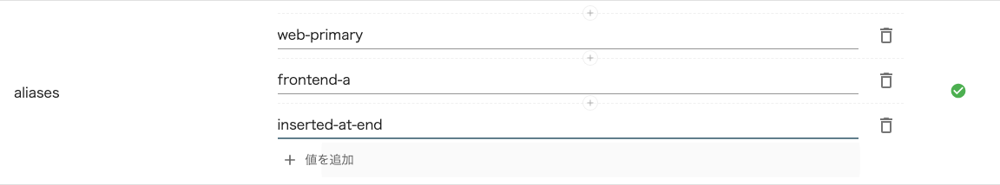 |
| 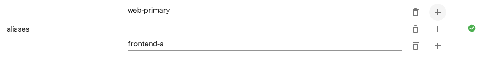 | 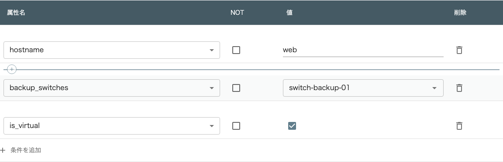 |

実測した並び順:

```
before, 1行目の ＋ を押した結果:  ["web-primary", "", "frontend-a"]
after,  gap 0 → gap 2:            ["inserted-at-top", "web-primary", "inserted-middle", "frontend-a"]
```

### 2-2. 行間の挿入（Jira 風）

| 既定（何も描かない） | 隙間に hover |
| --- | --- |
| 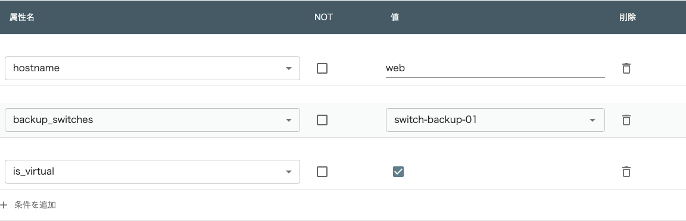 |  |

### 2-3. 末尾の追加行

| トリガー条件 | モデル属性 |
| --- | --- |
|  | 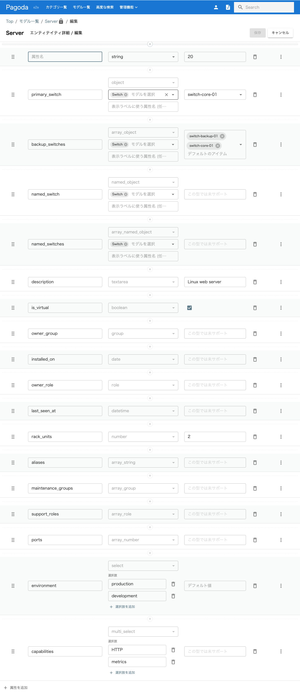 |

データ行と同じ高さ・罫線・行全体の hover を持ち、内容は追加ボタンのみです。

### 2-4. モデル編集 — 属性テーブル

| Before | After |
| --- | --- |
| 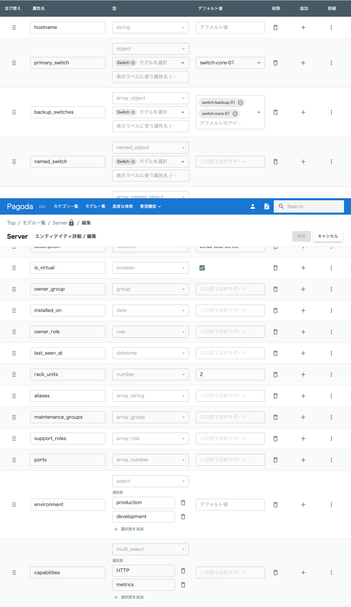 |  |
| 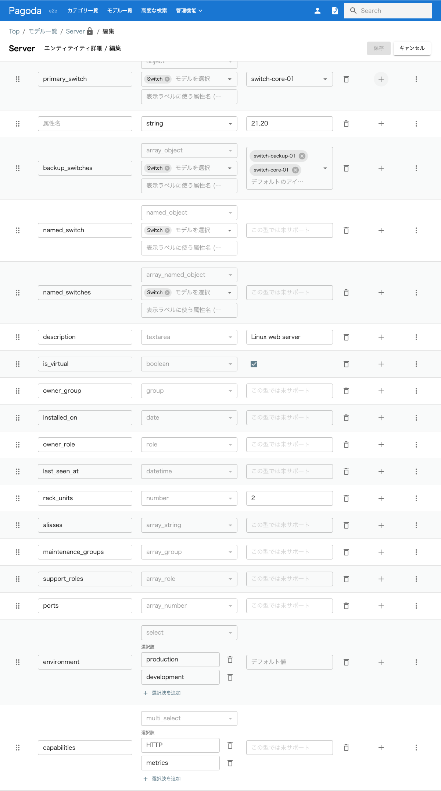 | 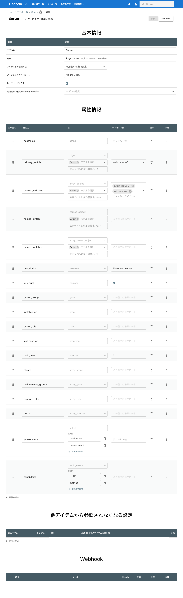 |

`追加` 列を削除。dnd-kit のドラッグハンドル列はそのまま残しています。

### 2-5. 参照ブロック設定（空状態）とトリガー

| Before | After |
| --- | --- |
|  |  |
| 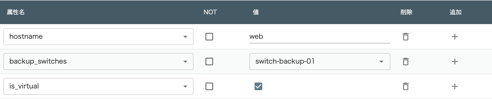 | 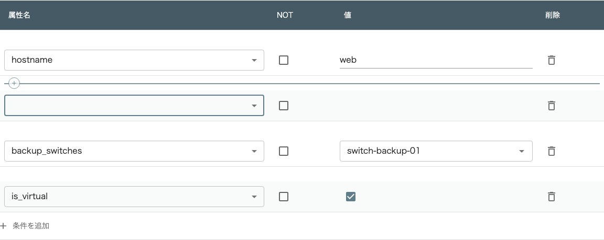 |

アクションは入れ子の値行に `✕`/`⊕` が並び、行レベルの `🗑`/`＋` とスコープが競合していました。
After では外側＝行間挿入＋末尾の追加行、入れ子＝`＋ 値を追加`（配列型のみ）に分離しています。

---

## 3. シナリオ別スクリーンショット

### 末尾の追加行で追加 → 新行にフォーカスが入る


### 境界で挿入 → 描いた位置に入る

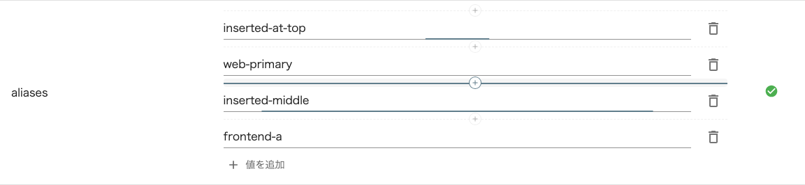

### 行間は既定では何も描かない（Jira 風）


### 隙間に hover すると細い線＋＋ が出る


### 追加ボタンは最終行として描画される


### 参照ブロック設定：空状態がラベル付き追加行


### 行内の操作は削除のみ


### トリガー条件：境界に挿入


### モデル属性：追加列が消え、境界挿入＋末尾追加行


### トリガーアクション：外側と入れ子のスコープ分離

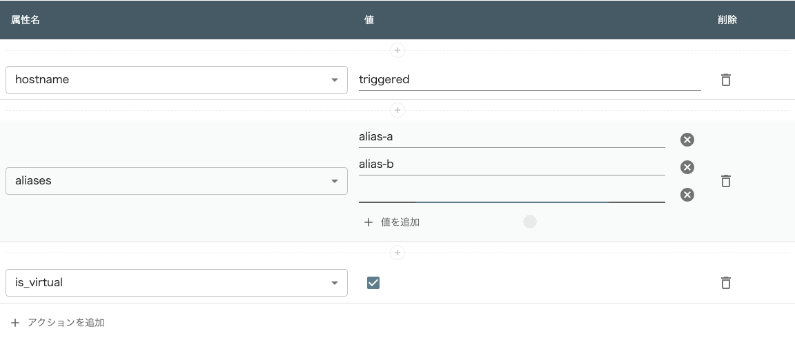

### アイテム編集：全体

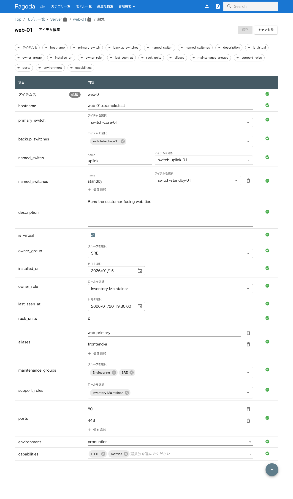

### モデル編集：全体


### トリガー編集：全体

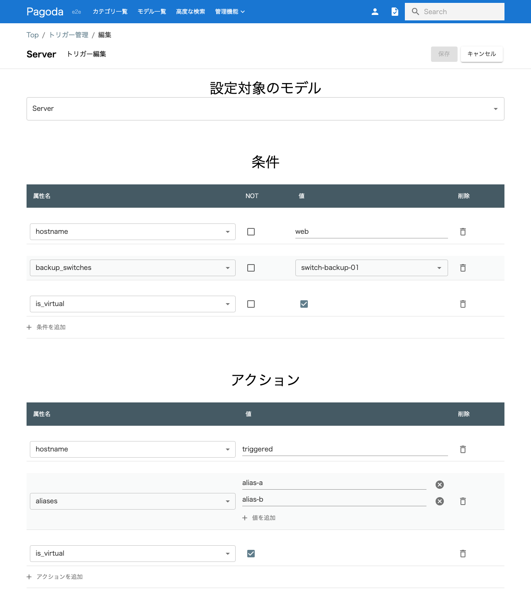

---

## 4. E2E ゲート結果（13 シナリオ）

| 結果 | シナリオ | 所要 |
| --- | --- | ---: |
| PASS | @gate1 entry array attribute appends at the end and focuses the new row | 1796 ms |
| PASS | @gate1 insertion band inserts exactly on the boundary it is drawn on | 1677 ms |
| PASS | @gate1 isolation rules render a visible append row when empty | 1736 ms |
| PASS | @gate1 whole screens keep their hierarchy | 3185 ms |
| PASS | @gate2 rows no longer expose a per-row plus button | 1121 ms |
| PASS | @gate2 trigger conditions insert on the boundary | 1109 ms |
| PASS | @gate2 entity attributes insert on the boundary | 1857 ms |
| PASS | @gate2 every insertion control has an accessible name | 1094 ms |
| PASS | @gate3 trigger action values append into their own action only | 1146 ms |
| PASS | @gate3 insertion bands are keyboard operable | 1135 ms |
| PASS | @gate4 the gap affordance stays hidden until hovered | 1369 ms |
| PASS | @gate4 the append control reads as the last row | 1036 ms |
| PASS | @gate3 narrow viewport does not widen the layout further | 3062 ms |

生ログ: [`logs/e2e-gate.txt`](logs/e2e-gate.txt)

---

## 5. ゲートを強化しながら見つけて直したもの

シナリオを 4 段階に分けて追加し、各段階で「落として → 直して → green」を確認しました。

| 段階 | 追加した観点 | その段階が捕まえたもの |
| --- | --- | --- |
| `@gate1` | 末尾追加＋フォーカス／境界挿入の順序／空状態／全体スクショ | — |
| `@gate2` | 行内に `＋` が無い／条件・属性の境界挿入／アクセシブル名 | axe が既存のラベル無し Select を検出 → ゲート対象を見直し／E2E フィクスチャの型不整合（MUI 警告）を修正 |
| `@gate3` | 入れ子 values のスコープ／キーボード操作／狭幅 | 挿入直後のフォーカス競合（rAF 二段）をテスト側で決定化／1024px の横幅超過は**変更前ビルドを実測して既存値**と確認し、ベースライン比較に変更 |
| `@gate4` | 行間が既定で不可視・hover で出現すること／追加行が最終行として描画されること | レビュー指摘（行間が邪魔・追加ボタンが取ってつけた感じ）を仕様化して固定 |

画面を見て直した点:

- 行間が常に破線で見えていて邪魔 → **既定では無描画、hover で細い線＋＋** に変更。
- 追加ボタンが浮いたボタンに見える → **データ行と同じ高さ・罫線・行 hover** を持つ「次の行」に変更。

---

## 6. 残課題・注意点

- 行間の操作は hover / キーボードフォーカスで出現するため、常時見えるのは末尾の追加行のみです（非 hover 経路として常設）。
- 挿入の誤クリック時は空行が 1 つ増えるだけです（削除は 1 クリック）。空行の自動除去は未実装です。
- dnd-kit のドラッグ並べ替えは、**変更前ビルドでも同じ挙動**（キーボード操作のシミュレーションでは順序が変わらない）であることを確認済みで、本変更による退行ではありません。

---

## 7. 再現方法

```bash
# 対象ブランチで
npm ci
npm run build
npx playwright test --config=e2e/playwright.config.ts e2e/rowInsertionGate.spec.ts
```
