# 行追加 UI の改善 — スクリーンショット付き検証レポート

対象ブランチ: `feature/row-insertion-upstream`（このドキュメントはコードを含みません）

- ベース: `upstream/master` (`6cb6f540`)
- 取得方法: 実フロントエンドバンドルをビルドし、Chromium で起動してモック API に対して**実際に操作**して撮影
- 単一ファイル版（画像を埋め込み）: [`report.html`](report.html) — そのままダウンロードして開けます

---

## 1. サマリ

各要素の行内にあった `＋`（行の縦中央にあり、押すと「その行の下」に入る）を廃止し、
**末尾のラベル付き追加行**と**行境界に描く挿入バンド**の 2 層に置き換えました。
操作の位置と追加される位置が一致するため、「押した場所＝入る場所」になります。

| 指標 | 結果 |
| --- | --- |
| アドホック E2E シナリオ | **11 件すべて PASS** |
| ユニットテスト（vitest） | 164 files / 1086 passed / 2 skipped |
| typecheck（tsconfig + tsconfig.test） | exit 0 |
| eslint（frontend + e2e） | 0 errors |
| production build | 0 errors |

E2E は全シナリオで console error・pageerror・失敗リクエスト・axe critical/serious・横スクロール・画面外コントロールも検査しています。

---

## 2. Before → After

### 2-1. アイテム編集 — 配列属性（`aliases` / array_string）

| Before | After |
| --- | --- |
| `＋` が行の中央にあり、押すとその行の下に入る | 行内は削除のみ／境界バンド＋末尾の `＋ 値を追加` |
|  |  |
|  | 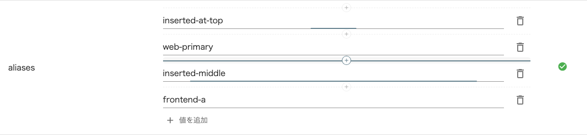 |

実測した並び順:

```
before, 1行目の ＋ を押した結果:  ["web-primary", "", "frontend-a"]
after,  band 0 → band 2:          ["inserted-at-top", "web-primary", "inserted-middle", "frontend-a"]
```

### 2-2. モデル編集 — 属性テーブル

| Before | After |
| --- | --- |
| 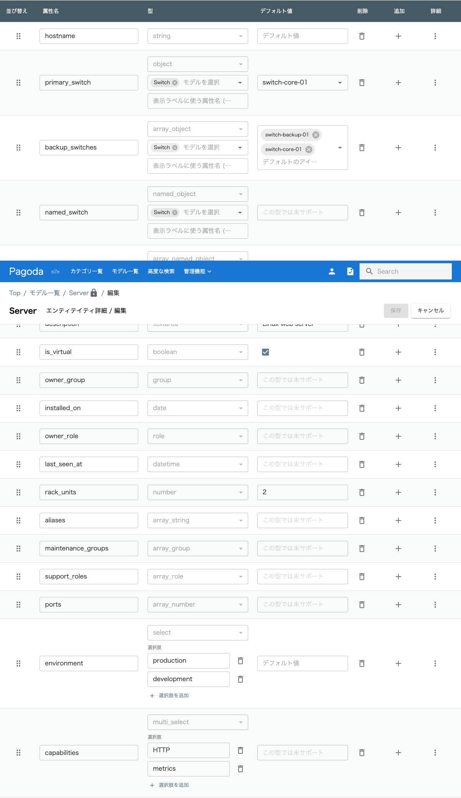 | 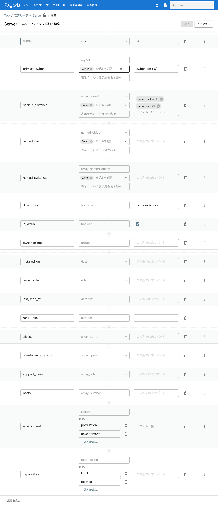 |
| 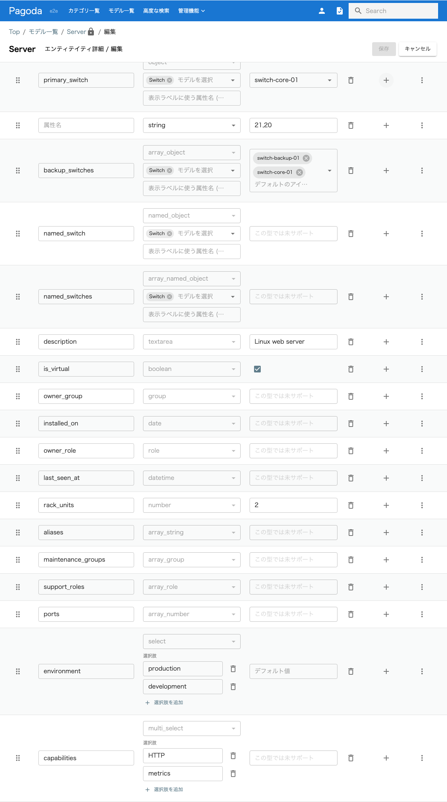 | 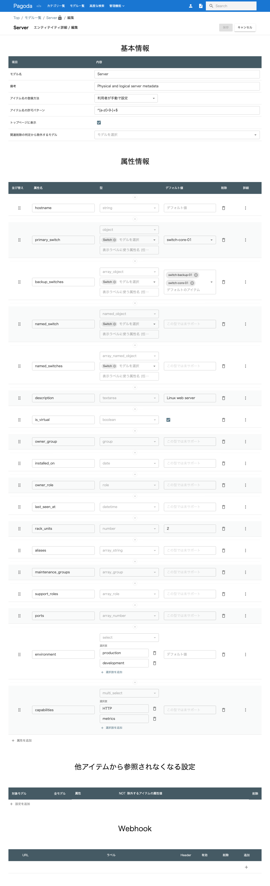 |

`追加` 列を削除し、境界バンド＋`＋ 属性を追加` に変更。dnd-kit のドラッグハンドル列はそのまま残しています。

### 2-3. モデル編集 — 参照ブロック設定（空状態）

| Before | After |
| --- | --- |
|  |  |

### 2-4. トリガー編集 — 条件 / アクション

| Before | After |
| --- | --- |
| 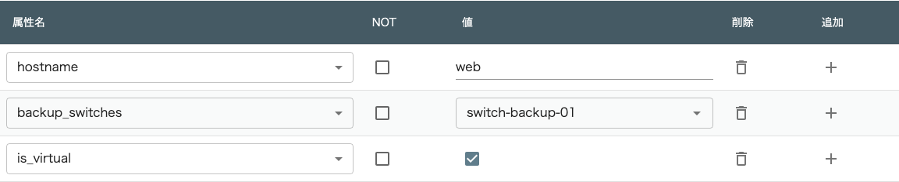 | 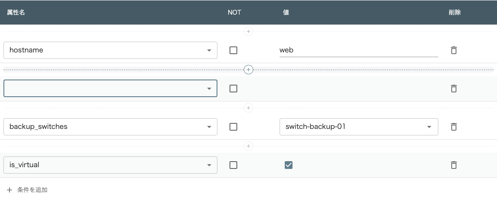 |
| 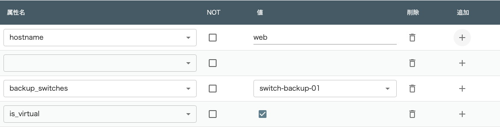 | 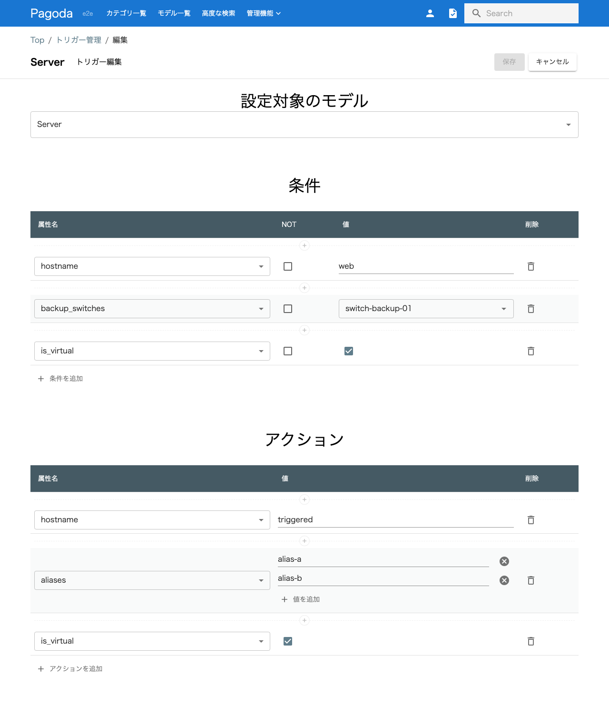 |

アクションは入れ子の値行に `✕`/`⊕` が並び、行レベルの `🗑`/`＋` とスコープが競合していました。
After では外側＝境界バンド＋`＋ アクションを追加`、入れ子＝`＋ 値を追加`（配列型のみ）に分離しています。

---

## 3. シナリオ別スクリーンショット

### 末尾の追加行で追加 → 新行にフォーカスが入る


### 境界バンドで挿入 → 描いた位置に入る


### 参照ブロック設定：空状態がラベル付き追加行


### 行内の操作は削除のみ


### トリガー条件：境界に挿入バンド


### モデル属性：追加列が消え、境界バンド＋末尾追加


### トリガーアクション：外側と入れ子のスコープ分離

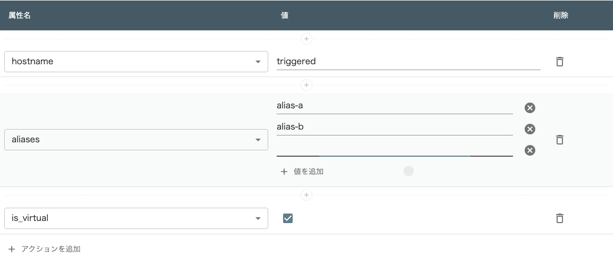

### アイテム編集：全体

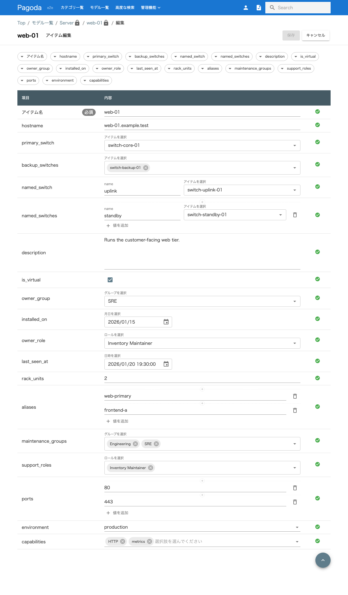

### モデル編集：全体


### トリガー編集：全体


---

## 4. E2E ゲート結果（11 シナリオ）

| 結果 | シナリオ | 所要 |
| --- | --- | ---: |
| PASS | @gate1 entry array attribute appends at the end and focuses the new row | 2432 ms |
| PASS | @gate1 insertion band inserts exactly on the boundary it is drawn on | 1904 ms |
| PASS | @gate1 isolation rules render a visible append row when empty | 2028 ms |
| PASS | @gate1 whole screens keep their hierarchy | 3546 ms |
| PASS | @gate2 rows no longer expose a per-row plus button | 1364 ms |
| PASS | @gate2 trigger conditions insert on the boundary | 1448 ms |
| PASS | @gate2 entity attributes insert on the boundary | 2193 ms |
| PASS | @gate2 every insertion control has an accessible name | 1224 ms |
| PASS | @gate3 trigger action values append into their own action only | 1479 ms |
| PASS | @gate3 insertion bands are keyboard operable | 1460 ms |
| PASS | @gate3 narrow viewport does not widen the layout further | 3407 ms |

生ログ: [`logs/e2e-gate.txt`](logs/e2e-gate.txt)

---

## 5. ゲートを強化しながら見つけて直したもの

シナリオを 3 段階に分けて追加し、各段階で「落として → 直して → green」を確認しました。

| 段階 | 追加した観点 | その段階が捕まえたもの |
| --- | --- | --- |
| `@gate1` | 末尾追加＋フォーカス／境界挿入の順序／空状態／全体スクショ | — |
| `@gate2` | 行内に `＋` が無い／条件・属性の境界挿入／アクセシブル名 | axe が既存のラベル無し Select を検出 → ゲート対象を見直し／E2E フィクスチャの型不整合（MUI 警告）を修正 |
| `@gate3` | 入れ子 values のスコープ／キーボード操作／狭幅 | 挿入直後のフォーカス競合（rAF 二段）をテスト側で決定化／1024px の横幅超過は**変更前ビルドを実測して既存値**と確認し、ベースライン比較に変更 |

画面を見て直した点:

- 境界バンドが濃すぎたため、破線の不透明度 0.8 → 0.5、高さ 16 → 14px に調整。
- 入れ子アクションの `＋ 値を追加` を全型に出してしまっていた（旧実装は配列型のみ）→ 配列型に限定し、ゲートにも「非配列型に追加ボタンが無い」検証を追加。

---

## 6. 残課題・注意点

- 行数の多い属性テーブルでは境界の破線がやや密に見えます。全境界に出す一貫性を優先しましたが、先頭バンドの省略やテーブル限定の密度調整は余地があります。
- 挿入バンドの誤クリック時は空行が 1 つ増えるだけです（削除は 1 クリック）。空行の自動除去は未実装です。
- dnd-kit のドラッグ並べ替えは、**変更前ビルドでも同じ挙動**（キーボード操作のシミュレーションでは順序が変わらない）であることを確認済みで、本変更による退行ではありません。

---

## 7. 再現方法

```bash
# 対象ブランチで
npm ci            # 依存（apiclient は npm run generate:client && npm run link:client）
npm run build
npx playwright test --config=e2e/playwright.config.ts e2e/rowInsertionGate.spec.ts
```

before 画像は、同じブランチで変更を stash して再ビルドした状態で同シナリオを実行して取得しています。
